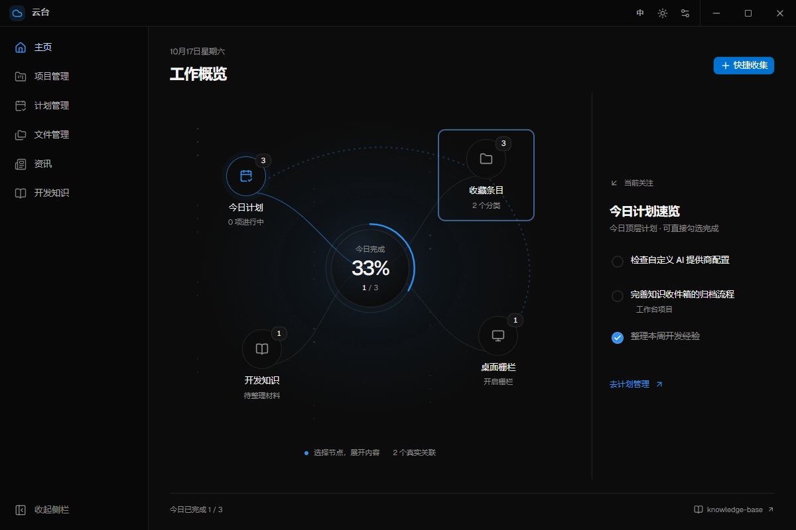

# NimbusDesk 云台

个人桌面工作台：计划、项目、文件、知识与统一搜索收在一个无边框窗口里，Windows 便携运行，数据全在本地。

> 这是一个自用的个人工具，按我自己的习惯设计。接口和行为会不预告地变。



## 功能

- **计划管理** —— 按天组织、任意层级嵌套，五种视图（大纲 / 看板 / 时间轴 / 日历 / 归档）。桌面可放「待办纸片」和贴边便签。
- **项目与迭代** —— 项目 / 迭代 / 工作项，与每日计划双向关联；可选接入禅道，只读指派给自己的任务，回写默认关闭且逐字段授权。
- **文件管理** —— 分类 + 标签收纳文件夹、文件与网址；文件夹映射让磁盘目录实时成为分类内容；每个分类可生成桌面悬浮栅栏，支持原生 OLE 拖出与拖入收集。
- **开发知识** —— 绑定 Obsidian vault，收件箱 / 经验 / 配方 / 收藏四类归档，全文搜索，AI 辅助整理。
- **统一搜索** —— 应用、文件、文档内容、知识库一处搜索，接入 Everything 时覆盖全盘文件名索引。
- **桌面贴边** —— 便签与栅栏可吸附屏幕左右上三边，成列排队，支持外观自定义、幽灵模式、分屏。

界面支持明暗主题（径向扩散切换）与中英文，全部自绘，无原生控件观感。

## 技术栈

| 方面 | 选择 |
| --- | --- |
| 框架 | Tauri 2（Rust 后端） |
| 前端 | React 19 + TypeScript + Vite |
| 状态 | Zustand + persist（落盘到自定义数据目录） |
| 样式 | TailwindCSS v4 + 自建 token 层 |
| 动效 | GSAP + View Transitions API |
| 存储 | SQLite（rusqlite）+ JSON 信封 |

## 开发

需要 Node 20+、pnpm、Rust 1.80+ 与 Tauri 2 的 Windows 构建依赖。

```bash
pnpm install
pnpm tauri dev      # 开发，前端跑在 127.0.0.1:17800
pnpm tauri build    # 打包
```

验证：

```bash
pnpm verify         # i18n、对比度、预览同步、tsc、全部前端测试与 Rust 测试
```

只跑一部分：

```bash
pnpm check:desktop   # 桌面窗口、栅栏、便签、文件操作
pnpm check:plans     # 计划、纸片、存储
pnpm check:projects  # 项目、禅道、备份
pnpm check:rust      # cargo test --lib
```

浏览器端的交互用例需要本机已装 Playwright 与 Chromium：

```bash
pnpm add -D playwright
node scripts/check-zentao-browser.mjs
```

脚本默认自动找 Edge / Chrome / Chromium；找不到时用 `PLAYWRIGHT_BROWSER` 指定可执行文件，用 `PLAYWRIGHT_MODULE` 指定 playwright 入口。

数据默认存在 exe 同级的 `data/`，不可写时回退 `%APPDATA%/nimbusdesk`。数据目录里只有数据文件，整个目录拷走即完成迁移。

## 许可

代码以 [MIT](LICENSE) 发布。

仓库里有第三方素材，各自条款不同，**不适用 MIT**：

| 位置 | 内容 | 许可 |
| --- | --- | --- |
| `public/neural/` | 主页动效素材与改编构图 | PolyForm Noncommercial 1.0.0，**禁止商业使用** |
| `src-tauri/resources/everything/` | Everything 便携版 | MIT（voidtools），随附 `License.txt` |
| 各依赖 | npm / crates.io 包 | 见 `public/licenses/` 与各包声明 |

出处与授权细节：`public/neural/SOURCE.md`、`docs/third-party/neural-creator-dashboard/`、`src-tauri/resources/everything/SOURCE.md`。
