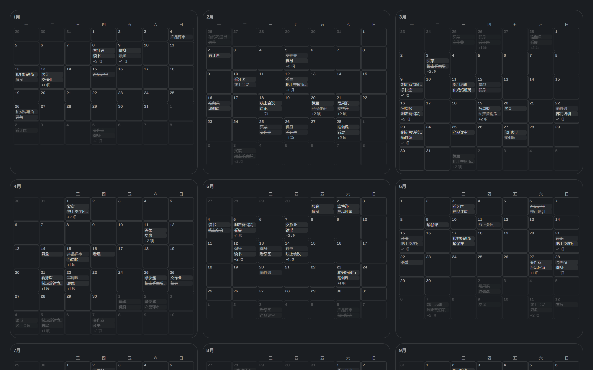

# 计划管理：年视图

日历视图切到「年」档，就是 12 个月格：每格把当天的事列出来，列不下的用「+N 项」收口。



## 为什么改

旧实现是 GitHub 贡献墙式的热力图：12 个方块矩阵按任务数量深浅染色。它只回答「哪天忙」，
不回答「那天是什么事」—— 想知道就得逐格点开。现在每格直接列出当天的任务名，
一眼能看出一年的时间花在哪。

## 怎么用

| 操作 | 结果 |
|---|---|
| 点某一天 | 跳到日视图的这一天（`onPick`） |
| 悬停某条 | 显示完整标题（格子窄，标题会被截断） |
| 悬停某一格 | 显示 `日期 · 完成/总数` |
| 今天 | 格子描品牌色边、日号变品牌色 |

## 取舍

- **每格只列 2 条**（`YEAR_CHIPS`）。1440 窗口下是 3 列，一格只有 ~62px 宽；
  多列一条整年就要多滚一屏，「一眼看一年」的用处就没了，剩下的走月视图同一套「+N 项」收口。
- **只列标题，不列时间**。`HH:mm` 前缀在 62px 里要吃掉一半，标题就只剩一两个字；
  时间在日 / 周视图里看。
- **颜色仍按状态**（待办 / 进行中 / 完成），复用月视图那几个 class，没有新增配色。
  参考图那种「每项一个颜色」在本项目里没有对应数据 —— 任务没有颜色字段，
  要补得先决定颜色从哪来（工作项？标题哈希？），那是另一个决定。
  顺带也是约束 5 的要求：新颜色得先进 `tokens.css` 的 primitive 层并过对比度闸门。
- **列数按宽度分档**：1 列（窄窗）→ 2 列（≥sm）→ 3 列（≥xl）。列越多格子越窄、标题截得越狠，
  所以不固定 4 列。
- 网格复用 `monthGrid()`（42 格、周一起，与月视图同源），不另写一套日期排布 ——
  两处各写一遍必然漂移。

## 为什么不换现成日历库

调研过 FullCalendar v6 / v7、schedule-x、tui.calendar、MUI X Scheduler、react-big-calendar：
月 / 周 / 日这些库都有，**年视图只有 FullCalendar 有**（`multiMonthYear`）。

真装真跑过一轮对比（同一份 225 个事件、同一套 token、同一窗宽）：

- v6.1（成熟线）三行配置就渲染出带标题、带时间、带溢出折叠的年视图；
  主题映射可行 —— 在容器上写 10 个 `--fc-*` 变量即可对上本项目 token
  （注意它运行时往 `<head>` 注入样式，覆盖要靠 id 或高优先级选择器）。
- v7.1（刚重写）网格塌成一列：类名变 `fc-classic-*` 哈希、样式换成 `--fc-classic-*` + theme 插件、
  入口从 `@fullcalendar/*` 改名成 `fullcalendar/*`。**现在不能用。**
- 体积约 260 KB 原始 / ~85 KB gzip，丢进懒块就不进入口闭包（当前入口闭包 540 KB / 900 KB）。

不换的理由不是体积，是**换掉的是网格、不是观感**：库给不了颜色来源与农历节日，
也给不了本项目已有的 `onPick` 跳转、双语、暗色与撤销体系；而月视图本来就有
「小片 + 另外 N 个」这套（`MAX_CHIPS` / `plans.moreTasks`），年视图只是把它平铺 12 份。
真要再评估，v6 那条线是可用后备。

## 怎么验证

```powershell
npm run dev
$env:PLAYWRIGHT_MODULE="…/playwright/index.mjs"
$env:PLAN_CALENDAR_ORIGIN="http://127.0.0.1:17800"
node scripts/shot-plan-calendar.mjs
```

夹具 `src/features/plans/fixtures/plan-calendar.html` 用确定性伪随机铺满一整年
（含一条超长标题，用来验证是截断而不是撑破网格）。脚本断言的都是用户能看见的东西：
12 个月格 × 42 天、每月 7 个星期名、格子里真的列出 ≥60 条任务名、出现「+N 项」收口、
任务名没被压成 0 宽、无运行时报错；通过后重拍 `docs/screenshots/plan-year.png`。
它**没有**接进 `verify:dist`（和 `check-plan-binding-browser.mjs` 一样是人工跑的），
改动年视图后手动跑一次。

## 已知边界

- 窄窗口（<sm）下退成 1 列，12 个月要滚很久 —— 格子宽但整页高。
- 一天的密度只有「最多 2 条 + N」这一个粒度，看全一天得点进日视图。
- 编辑仍在日 / 周视图做：年视图是只读浏览 + 跳转，不支持拖动改期。
