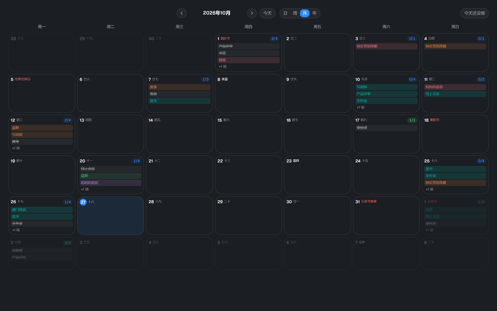
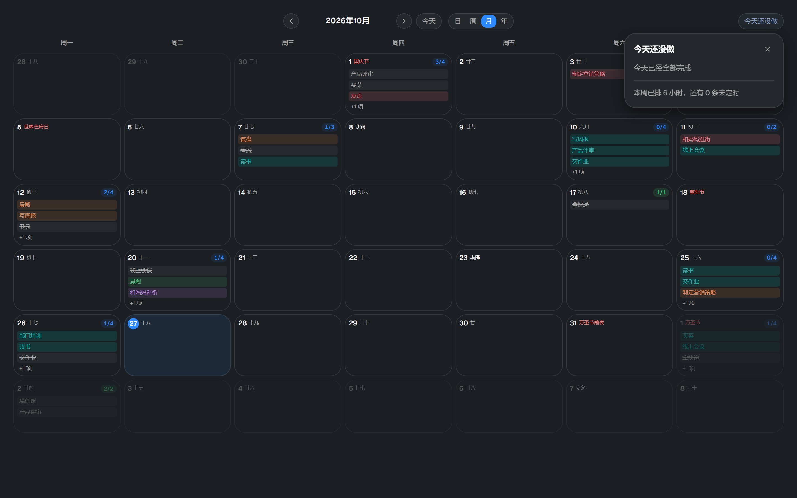

# 计划管理：日历视图

日历有日 / 周 / 月 / 年四档，共用一套导航（上一页 / 今天 / 下一页 + 档位切换）。
月视图每格列出当天的任务名，年视图是 12 个月格、每格也列任务名；两种视图里
每个任务名都带自己的事件色，日期旁边标农历 / 节气 / 节日。




## 怎么用

| 操作 | 结果 |
|---|---|
| 点某一天 | 跳到那一天（`onPick`） |
| 悬停某个任务名 | 显示完整标题（格子窄，标题会被截断） |
| 悬停某一格 | 显示 `日期 · 完成/总数` |
| 今天 | 描品牌色边、日号变品牌色 |
| 日 / 周视图 | 时间轴 × 多列；任务块可拖动改期（横向换天、纵向换时间，5 分钟吸附） |
| 右上角「今天还没做」 | 点开是一张浮层卡：今天还没勾掉的顶层任务（列表里直接可勾）+ 本周排了多少小时。点别处、× 或 Esc 收起 |

日 / 周 / 月 / 年四种视图里，日历都是**铺满**的。以前右边常驻一列 300px 的玻璃面板，
它的全部内容常常只是「今天已经全部完成」—— 为这句话付出的是一整张月历少看两列。
现在按需弹出（`PlansRail`，`role="dialog"`，点别处收起），按钮上带今天未完成的数量。



## 年视图为什么从热力墙改成事件块

旧实现是 GitHub 贡献墙式的方块矩阵：12 个方块按任务数量深浅染色。它只回答
「哪天忙」，不回答「那天是什么事」—— 想知道就得逐格点开。现在每格直接列出
当天的任务名，一眼能看出一年的时间花在哪。

## 事件色：这是哪条线的事

| 规则 | 说明 |
|---|---|
| 取键 | 绑了工作项就按**工作项**取；没绑就按任务自身 |
| 为什么 | 同一条线的事在日历上连成一片，这才是颜色能回答的问题；没绑的退回自身，至少每条有颜色、不至于一片灰 |
| 怎么取 | id 的 FNV-1a 哈希落到 5 色之一（`eventColorIndex`）。用哈希而不是「第几个出现的」—— 后者滚动或换视图时会改色，颜色一变就再也认不出 |
| 长什么样 | 淡底 + **同色文字**（`bg-event-N/15 text-event-N`），与「已完成/总数」那个 `bg-success/15 text-success` 徽章同一套写法。不描边 —— 一排带框的小药丸读起来又碎又廉价 |

「进行中」不参与身份色：它固定用品牌蓝实心，那是「现在」的强信号，不该被身份色顶掉。
完成态一律中性灰 + 删除线。

**五个色相**：玫红 / 珊瑚橙 / 翠绿 / 青碧 / 紫罗兰（`tokens.css` 的 `--pr-event-1..5`）。

刻意**不要黄与黄绿**：在正文需要的明度上，那两档渲染出来是橄榄与土黄，混在一排里就是「脏」，
加饱和度也救不回来（黄色要亮才像黄色，而亮到能叫黄就过不了浅色底上的 4.5:1）。
与品牌蓝（渲染 ≈216°）留 ≥20°：不然蓝色块会被读成品牌强调。
深色档不是简单提亮 —— 明度一变渲染色相也会动，两组是各自调的。

事件色既是底色也是文字色，所以两档都按**正文 4.5:1** 断言；色相两两 ≥22°、距品牌 ≥20° 也都在
`scripts/check-contrast.mjs` 的「事件色」段里（深浅两档各自校验）。

增删颜色要同时改四处：`tokens.css` 的 primitive / semantic 两层（含 `.dark` 重取明度）、
`index.css` 的 `@theme`、`views/shared.tsx` 的类名表，以及 `types.ts` 的 `EVENT_COLORS`。

## 农历 / 节气 / 节日

日期旁边一个小标签，按中文日历的惯例排优先级：
**节日（公历 + 农历）> 节气 > 农历初一（显示月名）> 农历日**。
三档深浅都取自对比度闸门覆盖过的 token：节日用红（中文日历惯例）、节气用正文色、
普通农历日最弱 —— 于是「这天为什么特殊」不用读字也能看出来。

- 数据来自 `lunar-typescript`（1.8.6，MIT，纯计算、无网络），包在 `src/lib/lunar.ts` 里收口成一个纯函数。
  只需只读展示，**不参与任何落盘**，所以不影响备份格式。
- **只在中文界面渲染**：这套名字（廿三、立春、中元节）翻成英文没有意义。
- **没有「法定节假日 / 调休」**：那是每年公布的安排，不是历法推算。
  库的 `getFestivals()` 里也有「世界住房日」这类国际日，一并显示 —— 不自己维护一份白名单，
  否则每年都要跟着改。

## 为什么不换现成日历库

调研过 FullCalendar v6 / v7、schedule-x、tui.calendar、MUI X Scheduler、react-big-calendar：
月 / 周 / 日这些库都有，**年视图只有 FullCalendar 有**（`multiMonthYear`）。

真装真跑过一轮对比（同一份 225 个事件、同一套 token、同一窗宽）：

- v6.1（成熟线）三行配置就渲染出带标题、带时间、带溢出折叠的年视图；主题映射可行 ——
  在容器上写 10 个 `--fc-*` 变量即可对上本项目 token（注意它运行时往 `<head>` 注入样式，
  覆盖要靠 id 或高优先级选择器）。
- v7.1（刚重写）网格塌成一列：类名变 `fc-classic-*` 哈希、样式换成 `--fc-classic-*` + theme 插件、
  入口从 `@fullcalendar/*` 改名成 `fullcalendar/*`。**现在不能用。**
- 体积约 260 KB 原始 / ~85 KB gzip。

不换的理由不是体积，是**换掉的是网格、不是观感**：库给不了事件色与农历，
也给不了本项目已有的 `onPick` 跳转、双语、暗色与撤销体系；而月视图本来就有
「小片 + 另外 N 个」这套（`MAX_CHIPS` / `plans.moreTasks`），年视图只是把它平铺 12 份。
真要再评估，v6 那条线是可用后备。

## 怎么验证

```powershell
npm run dev
$env:PLAYWRIGHT_MODULE="…/playwright/index.mjs"
$env:PLAN_CALENDAR_ORIGIN="http://127.0.0.1:17800"
node scripts/shot-plan-calendar.mjs
```

夹具 `src/features/plans/fixtures/plan-calendar.html`（`?view=year` 挂年视图、`?view=month` 挂月视图）
用确定性伪随机铺满一整年，含一条超长标题（验证是截断而不是撑破网格）、三条工作项
（验证同一条线一个颜色）。脚本断言的都是用户能看见的东西：12 个月格 × 42 天、每月 7 个星期名、
格子里真的列出任务名、出现「+N 项」收口、月格内容不溢出卡片边框、农历标签每一天都有、
1 月 1 日 / 5 月 1 日 / 10 月 1 日标成元旦 / 劳动节 / 国庆节、标出了节气、节日用了强调色、
不同工作项的任务真的不是同一个颜色（取计算样式比对）、色板 5 色都用的到、颜色序号稳定且在范围内、
右侧面板默认不存在而点入口才弹出、点别处收起、无运行时报错；通过后重拍
`docs/screenshots/plan-year.png`、`plan-month.png`、`plan-month-rail.png`。

它**没有**接进 `verify:dist`（和 `check-plan-binding-browser.mjs` 一样是人工跑的），
改日历后手动跑一次。颜色与农历的口径已经进 `verify`（`check:contrast` 的事件色段）。

## 已知边界

- 窄窗口（<sm）年视图退成 1 列，12 个月要滚很久；格子宽但整页高。
- 年视图一天只有「最多 2 条 + N」这一个粒度，看全一天得点进日视图。
- 编辑在日 / 周 / 月视图做：年视图是只读浏览 + 跳转，不支持拖动改期。
- 事件色按任务自己身上写的 `workItemId` 取；「缺省继承祖先」是在 `resolvePlanWorkItem()` 里做的，
  日历只拿得到当天的扁平任务列表，所以子任务不会自动染上父任务的颜色。
- 颜色的**含义**要在日历上待一会儿才认得出来（没有图例）。目前不加图例：没绑工作项的任务按自身取色，
  本来就没有一句话能概括的图例。
