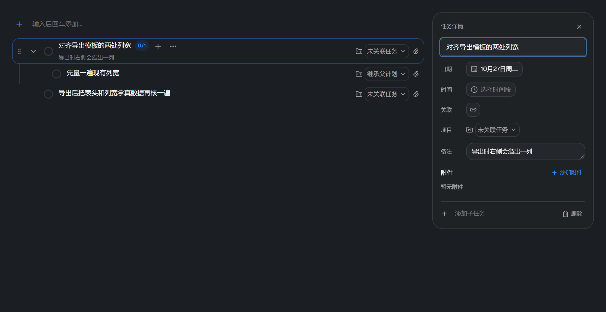
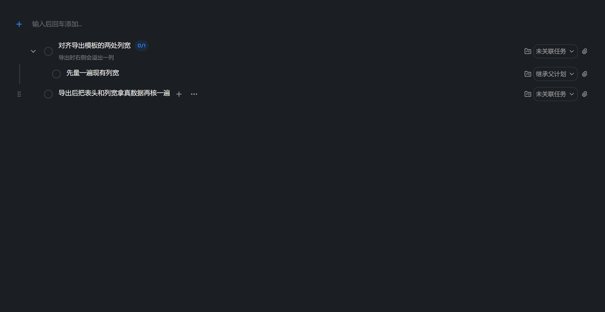

# 计划管理：任务详情栏

大纲视图变成两栏：左边是任务列表，右边是「这一条」的详情。点标题（或标题下那行备注）
把这一条放进右栏，再点一次收起，右上角的 × 或 Esc 也能收。



## 为什么改

旧实现是「点标题 → 这一行长高成编辑框」，一保存就重排：下方所有行整体上移，
而 pointerup 落在屏幕同一坐标上，此时命中的已经是**另一行**的控件
（真的点错过删除按钮，所以 `useDismiss` 里留了一段「必须吞掉这次点击」的补丁）。
中间版本试过浮层卡片，但它会压住下面几行，备注也放不开。现在是列表右边独立一栏：
不盖任何一行，行本身的高度在正常窗宽下恒定。

行上只保留「这一条是什么」：状态、标题、进度徽章、关联徽标、时间范围、备注、项目、附件。
「改这一条」的动作全部收进右栏 —— 一行五个按钮减到两个（项目与附件是信息入口，不是动作）。

## 怎么用

| 操作 | 结果 |
|---|---|
| 点标题 | 选中这一条，右栏显示详情，光标落在标题；再点一次收起 |
| 点标题下那行备注 | 同样开右栏，但光标落在**备注**里（点它就是为了看/续写备注） |
| 行上的 + | 就在这一行下面长出子任务输入框，回车即落库（右栏里也有同一入口） |
| 日期 | 月历里点一天改期；今天 / 明天两个快捷键。**连同子任务一起挪**（`moveTaskToDate`）；挪到别的日子后右栏自动收起 |
| 时间 / 关联 / 项目 | 原有的选择器，改完即生效 |
| 备注 | 文本域：默认一行，右下角可往下拉 |
| 添加子任务 | 右栏底部输入，回车即落库（多行粘贴仍会拆成多条） |
| 删除 | 右栏右下角，走原有的二次确认 |
| 拖动把手 | 行最左侧，悬停显形。同一层级内换位（`reorderTask`），落点画在目标行的上/下边；把手聚焦后 ↑↓ 也能换位 |
| Esc | 落地改动并收起右栏 |

标题与备注是草稿，**提交时才写一次**：逐字符 `updateTask` 会把撤销栈灌满，
撤销就变成逐字回退。其余字段一次改动就是一个动作，直写。
标题里回车只落地、**不**收栏 —— 收栏是另一个动作。

两个悬停才显形的控件（把手、`+`）都排在**标题后面**：动作挤在一处，
不用去行两端各找一遍。它们**常驻占位、只改透明度** —— 悬停才「挤出来」会让整行文字横向跳动。
触屏没有悬停这回事，所以 `@media(hover:none)` 下一律常显。
行上**没有**「更多 / ⋯」按钮：开详情就是点标题，多一个按钮只是多一个要找的东西。



## 代价与边界

- **列表会变窄**。窄窗下标题会换行，行会变高 —— 那仍是「下方行整体下移」，
  只是这次由窗口宽度触发，不是编辑态触发的。窗口够宽就不会（夹具按正常窗宽断言）。
- 详情栏只跟着**大纲**视图（选中状态在这一视图里）；时间轴/看板/统计不受影响，
  看板卡片仍是就地改名。
- 改期是**跨日期搬家**，不是「任务带一个日期字段」：日期就是它的存储位置（`days[date]`），
  所以没有「清除日期」，想换天就点另一个日子，想撤就 Ctrl+Z。
- 顶部那个快速添加框去掉了卡片边框与背景，就是一行「＋ 输入后回车添加…」——
  它本来就是这一天的第一行任务。注意 `index.css` 有一条**不带 `@layer`** 的全局
  `:focus-visible { outline: 2px solid var(--ring) }`，它压得过 Tailwind 的 `outline-none`，
  所以无框输入框必须自己留内边距，否则聚焦时那圈蓝边会贴着文字。

## 已完成分组

完成项不再是「两条细线夹一个居中标签」，而是一个**可折叠的分组头**：`⌄ 已完成 2`。
一整组完成项是「回头看一眼」用的，平时收起来让位给还没做的；计数跟着头走，
收起来也知道完成了几条。收起只是不渲染，数据一条不动（`aria-expanded` 同步）。

勾选框的完成态也从品牌蓝改成**中性灰实心**：一整组连成一片时，
品牌蓝会把它们喊成「还要注意」。改的是 `views/shared.tsx` 的 `StatusButton`，
所以大纲、看板、归档只读树、桌面纸片四处一起变。

（完成项标题仍带删除线 —— 那是本应用既有的约定，参考图里只是褪色。）

## 纸片功能整体拆除（待办）

计划页工具栏上的「放到桌面上」按钮已删除：此前开着的纸片仍随启动恢复，但界面里
目前没有办法把新的一天放上桌面。整个纸片功能还没拆，它横跨前后端，得单独一次改：

- 前端：`stores/papers.ts`、`views/paper.tsx`、`views/paper-row.tsx`、`views/capsule.tsx`、
  `window-runtime.ts`、`capsule*.ts`、`main.tsx` 的 `todo-` 分支、`main-runtimes.tsx` 的启动恢复。
- 桌面层：`desktop/registry.ts` 的 `todo-` 分支（桌边/泊岸/胶囊**与栅栏共用**，是剥开不是删除）。
- Rust：`commands/sys.rs` 的建窗命令 + `lib.rs` 注册 + `state_merge.rs`/`database.rs` 里
  「计划与纸片成对写库」的事务。
- 备份：格式 2 写着「11 个模块状态」，删掉 papers 就是格式变更，要升版并保证旧备份仍可读。
- 测试与文档：`sticky-plan-browser`、`paper-title-dock-browser`、`desktop-actions`、
  `sticky-presentation`、`storage-and-daily-todo.md`、`dock-capsule.md` 等。

## 验证

```powershell
npm run dev
$env:PLAYWRIGHT_MODULE="…/playwright/index.mjs"   # Playwright 不是项目依赖
node scripts/check-plan-outline-browser.mjs
node scripts/shot-plan-outline.mjs                # 重新生成两张截图
```

夹具 `src/features/plans/fixtures/plan-outline.html`（mock 原生 IPC + 真 `OutlineView`）
断言的都是看得见的东西：开详情栏前后行的纵向几何一致、行上不再有「更多」按钮、页面上零浮层、
字段标签各一个、备注是文本域、点备注行进右栏时焦点在备注而非标题、
标题回车后立刻反映到行上且右栏不关、选中可以再点一次收起、
完成分组头带 `aria-expanded` 且收起不丢数据、拖动与 ↑↓ 都能换序且落进 DOM 顺序、
改期后今天为空而明天拿到整棵子树、空状态点击后焦点回到添加框。
