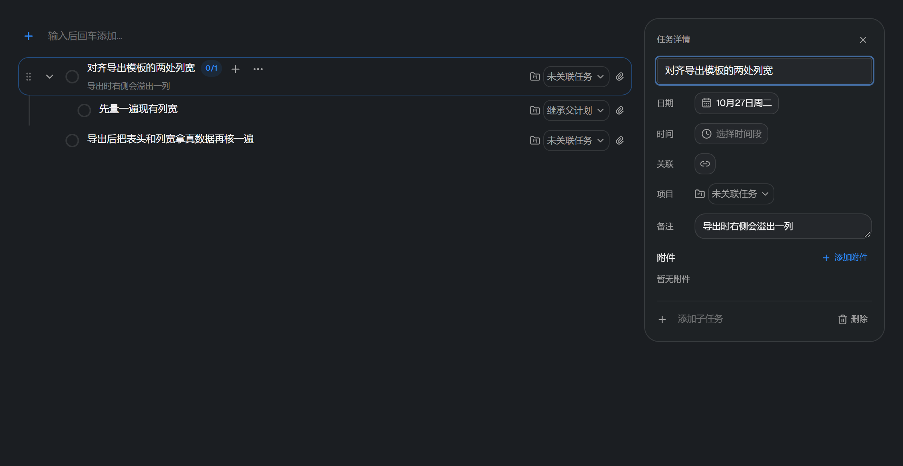
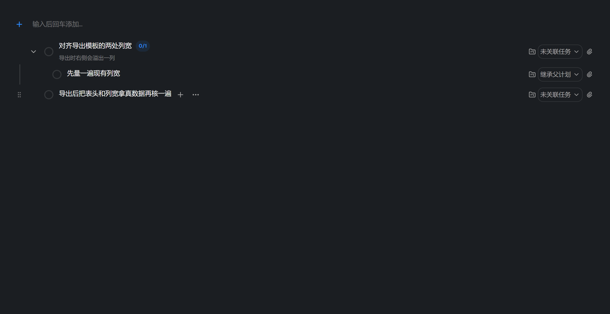

# 计划管理：备注栏 + 详情卡片

大纲视图是两栏：左边任务列表，右边**只有备注** —— 点标题或标题下那行备注都会把这一条放进右栏，
光标直接落在备注里；离开焦点即存，没有保存按钮。

完整的任务详情卡片（日期 / 时间 / 关联 / 项目 / 附件 / 子任务 / 删除）收在行上的 `⋯` 里，
点开是**贴着那个 `⋯` 向右下展开的浮层**（Radix `Popover`，`align="start" side="bottom"`），
Esc / × / 点别处关闭；下方空间不够时它会自动翻到按钮上方。右栏不再承载这些字段。
右栏备注一直铺到窗口底部（`h-full` 一路撑开，列表列自己滚），不再是固定 288px 的小盒子。



## 为什么改

旧实现是「点标题 → 这一行长高成编辑框」，一保存就重排：下方所有行整体上移，
而 pointerup 落在屏幕同一坐标上，此时命中的已经是**另一行**的控件
（真的点错过删除按钮，所以 `useDismiss` 里留了一段「必须吞掉这次点击」的补丁）。
中间版本试过浮层卡片，但它会压住下面几行，备注也放不开。现在是列表右边独立一栏：
不盖任何一行，行本身的高度在正常窗宽下恒定。

行上只保留「这一条是什么」：状态、标题、进度徽章、时间范围、备注、附件徽标。
项目关联与链接不再出现在行上（详情卡片里已有一份，重复摆就是噪音）；动作只剩「加子任务」和 `⋯`。

## 怎么用

| 操作 | 结果 |
|---|---|
| 点标题 | 选中这一条，右栏开备注栏并聚焦备注；再点一次收起（× / Esc 同效） |
| 点行的空白处 | 同样选中这条、右栏开备注栏（`onSelect(id, "note")`，不会误触按钮） |
| 点标题下那行备注 | 同样开备注栏并聚焦备注（点它就是为了看/续写备注） |
| 行上的 ⋯ | 打开完整详情卡片浮层：日期 / 时间 / 关联 / 项目 / 附件 / 子任务 / 删除 |
| 行上的 📎 | 在 `+` 左边：附件的增删看这里，不占详情卡片的位置 |
| 双击标题或备注行 | 同样打开详情浮层 —— 右手不用先去够行尾的 `⋯` |
| 行上的 + | 就在这一行下面长出子任务输入框，回车即落库（详情卡片里也有同一入口） |
| 日期 | 详情卡片里点一天改期；今天 / 明天两个快捷键。**连同子任务一起挪**（`moveTaskToDate`）；挪到别的日子后行与备注栏一起消失 |
| 时间 / 关联 / 项目 | 详情卡片里的原有选择器，改完即生效 |
| 备注 | 右栏文本域：占满整栏、与页面同色，离开焦点即存，没有保存按钮 |
| 添加子任务 | 详情卡片底部输入，回车即落库（多行粘贴仍会拆成多条） |
| 删除 | 详情卡片右下角，走原有的二次确认 |
| 拖动把手 | 行最左侧，悬停显形。同一层级内换位（`reorderTask`），落点画在目标行的上/下边；把手聚焦后 ↑↓ 也能换位 |
| Esc | 落地改动并收起右栏 |

标题与备注是草稿，**提交时才写一次**：逐字符 `updateTask` 会把撤销栈灌满，
撤销就变成逐字回退。其余字段一次改动就是一个动作，直写。
标题里回车只落地、**不**收栏 —— 收栏是另一个动作。

两个悬停才显形的控件（把手、`+`）都排在**标题后面**：动作挤在一处，
不用去行两端各找一遍。它们**常驻占位、只改透明度** —— 悬停才「挤出来」会让整行文字横向跳动。
触屏没有悬停这回事，所以 `@media(hover:none)` 下一律常显。
行上**没有**「更多 / ⋯」按钮：开详情就是点标题，多一个按钮只是多一个要找的东西。



## 代价与边界

- **列表会变窄**。窄窗下标题会换行，行会变高 —— 那仍是「下方行整体下移」，
  只是这次由窗口宽度触发，不是编辑态触发的。窗口够宽就不会（夹具按正常窗宽断言）。
- 详情栏只跟着**大纲**视图（选中状态在这一视图里）；时间轴/看板/统计不受影响，
  看板卡片仍是就地改名。
- 改期是**跨日期搬家**，不是「任务带一个日期字段」：日期就是它的存储位置（`days[date]`），
  所以没有「清除日期」，想换天就点另一个日子，想撤就 Ctrl+Z。
- 顶部那个快速添加框去掉了卡片边框与背景，就是一行「＋ 输入后回车添加…」——
  它本来就是这一天的第一行任务。注意 `index.css` 有一条**不带 `@layer`** 的全局
  `:focus-visible { outline: 2px solid var(--ring) }`，它压得过 Tailwind 的 `outline-none`，
  所以无框输入框必须自己留内边距，否则聚焦时那圈蓝边会贴着文字。

## 已完成分组

完成项不再是「两条细线夹一个居中标签」，而是一个**可折叠的分组头**：`⌄ 已完成 2`。
一整组完成项是「回头看一眼」用的，平时收起来让位给还没做的；计数跟着头走，
收起来也知道完成了几条。收起只是不渲染，数据一条不动（`aria-expanded` 同步）。

勾选框的完成态也从品牌蓝改成**中性灰实心**：一整组连成一片时，
品牌蓝会把它们喊成「还要注意」。改的是 `views/shared.tsx` 的 `StatusButton`，
所以大纲、看板、归档只读树三处一起变。

（完成项标题仍带删除线 —— 那是本应用既有的约定，参考图里只是褪色。）

## 桌面纸片功能已整体拆除

计划页工具栏上的「放到桌面上」按钮先删掉了，随后整个纸片功能一并拆除 —— 现在没有
「把某一天送上桌面」这件事，桌面上的常驻窗口只剩文件栅栏。

拆掉的东西横跨前后端：`stores/papers.ts`、`views/paper.tsx` / `paper-row.tsx` / `capsule.tsx`、
`capsule.ts`、`capsule-window.ts`、`paper-interactions.ts`、`window-runtime.ts`、`main.tsx` 的
`todo-` 分支、`main-runtimes.tsx` 的启动恢复、`desktop/registry.ts` 的 `todo-` 条目、
Rust 的 `open_todo_paper` / `close_todo_paper` / `list_todo_papers` 三个命令与 `todo-*` 能力、
数据库 `module_state` 的 `plans/papers` 命名空间。

**桌边 / 泊岸 / 胶囊那套机器没有删**：它由文件栅栏继续使用，`desktop/registry.ts` 现在
只产出 `fence-*` 条目。

备份格式升到 3（不再带 `todo-papers`）；恢复仍接受 1/2 的旧包，包里那份 `todo-papers`
被安静忽略。存储与同步的细节见 `storage-and-daily-todo.md`。

## 验证

```powershell
npm run dev
$env:PLAYWRIGHT_MODULE="…/playwright/index.mjs"   # Playwright 不是项目依赖
node scripts/check-plan-outline-browser.mjs
node scripts/check-plans-browser.mjs                # 备注栏高度 / 详情浮层位置 / 双击
node scripts/shot-plan-outline.mjs                # 重新生成两张截图
```

`check-plans-browser.mjs` 覆盖这一栏的三件事：点开备注后文本域高度接近视口（不是原来的 288px 小盒）、
`⋯` 的详情浮层出现在按钮**右下方**、Esc 关得掉、双击备注行也能开。

夹具 `src/features/plans/fixtures/plan-outline.html`（mock 原生 IPC + 真 `OutlineView`）
断言的都是看得见的东西：开详情栏前后行的纵向几何一致、行上不再有「更多」按钮、页面上零浮层、
字段标签各一个、备注是文本域、点备注行进右栏时焦点在备注而非标题、
标题回车后立刻反映到行上且右栏不关、选中可以再点一次收起、
完成分组头带 `aria-expanded` 且收起不丢数据、拖动与 ↑↓ 都能换序且落进 DOM 顺序、
改期后今天为空而明天拿到整棵子树、空状态点击后焦点回到添加框。
